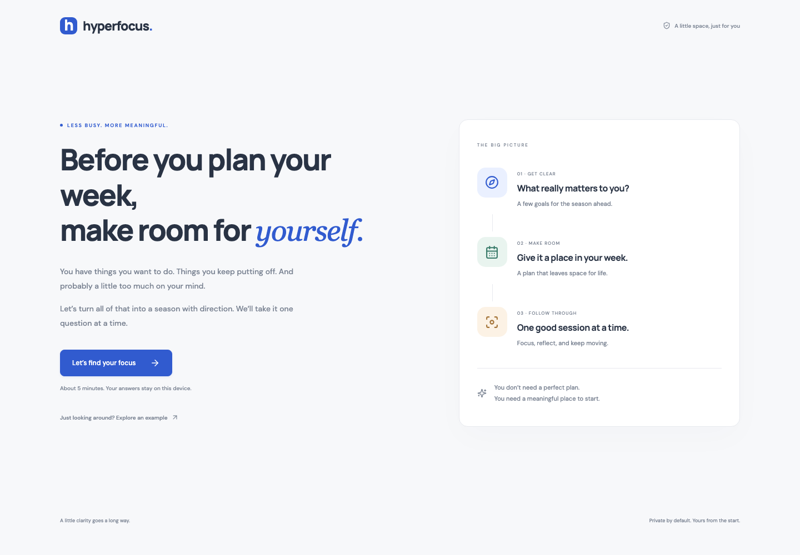

# Hyperfocus

An independent, open-source workspace for turning seasonal goals into planned time and focused work. MIT licensed. Local-first. No account, subscription, telemetry, or API key.



```sh
npm ci
npm run dev
```

Open **http://127.0.0.1:5180**. Requires Node.js 22.12 or newer. Your first visit opens guided season setup: introduction, season dates, brain dump, goal questions, a realistic time budget, plan review, and a signed commitment. Answers save as you go. Completing setup opens your season, with your goals and first actions ready. The example workspace is an explicit choice on the welcome screen.

| Area              | Included                                                                                                                                                                                          |
| ----------------- | ------------------------------------------------------------------------------------------------------------------------------------------------------------------------------------------------- |
| Onboarding        | Resumable first-run flow, goal reasons and finish lines, priority and capacity checks, optional first focus block, and a signed commitment. Revisit from Settings without deleting existing work. |
| Seasons           | Editable dates, ranked goals, weekly time budgets, reasons, and checkable milestones                                                                                                              |
| Planning          | Task CRUD, completion, day/week calendar, drag tasks to schedule, drag blocks to move, precise block editor, overlap prevention                                                                   |
| Week draft        | Deterministic proposal from unfinished tasks, free weekday work hours, review and remove suggestions before applying                                                                              |
| Focus             | Persistent countdown, pause/resume, session ratings, generated brown noise, optional completion tone                                                                                              |
| Compass           | Actual focus minutes, 7-day chart, goal time coverage, daily reflections and energy ratings                                                                                                       |
| Data              | Versioned and validated local storage, JSON backup/restore, iCalendar export, dark mode, search                                                                                                   |
| Blocking          | Optional unpacked [Chrome companion](extension/README.md) for website navigation during focus sessions                                                                                            |
| Architecture      | [Domain, application, infrastructure, UI boundaries](docs/architecture.md); no backend required                                                                                                   |
| Research          | [Sources, observed behavior and parity limits](docs/research.md)                                                                                                                                  |
| Privacy           | Data lives in this browser profile. Fonts and audio are local. Browser storage is not encrypted. Export backups before clearing site data or changing devices.                                    |
| Multi-tab use     | Changes propagate through storage events. Concurrent edits use last-write-wins. Use one planner tab for active sessions and blocking.                                                             |
| AI / integrations | Suggestions use visible local rules. Conversational AI, OAuth calendar sync, Slack, native apps and cross-device sync are not implemented.                                                        |

```sh
npm run check                    # ESLint, domain/storage tests, TypeScript, production build
npx playwright install chromium
npm run test:e2e                 # Desktop and mobile Chromium workflows
npm run build
npm run preview                 # Production build on port 4173
```

Deploy `dist/` to any static host over HTTPS. Keep a consistent origin because storage is origin-specific. The browser extension trusts only the documented localhost origins until explicitly configured for your deployment. No service worker is installed; first load and uncached page chunks need the static host available.

Contributions: [CONTRIBUTING.md](CONTRIBUTING.md). Security: [SECURITY.md](SECURITY.md). Hyperfocus is not affiliated with Superfocus, Ali Abdaal, or SuperOS. No proprietary source, artwork, or branding is included.
