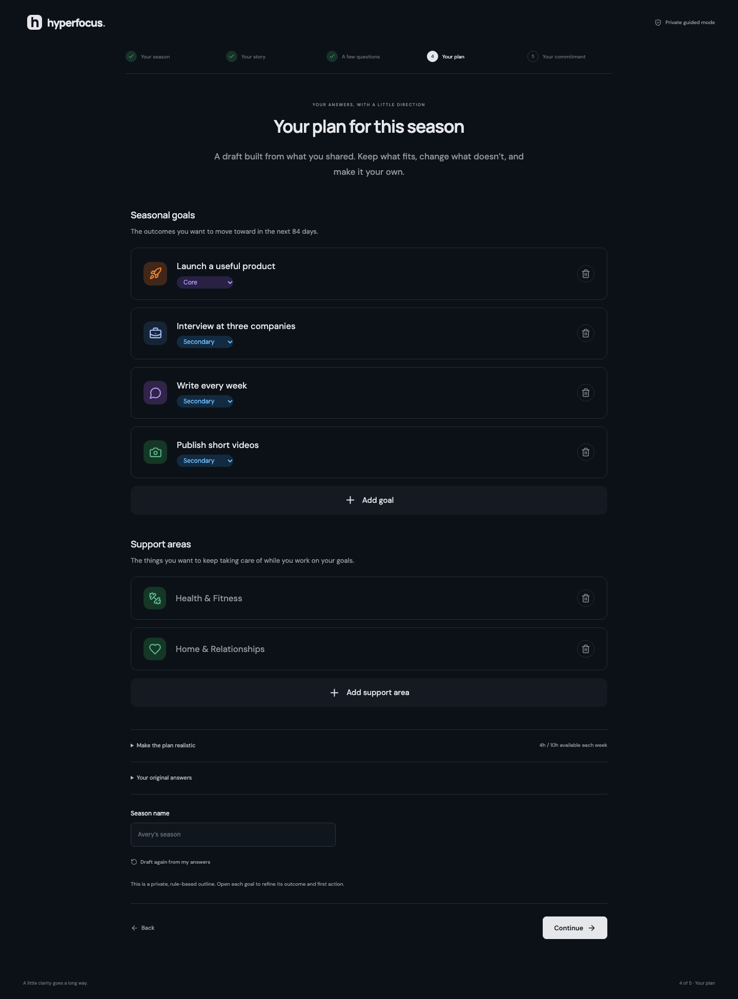

# Hyperfocus

An independent, MIT-licensed workspace for goals, time, and focused work. Local-first, with a private guided planner and an optional connected AI coach.



```sh
npm ci
npm run dev
```

Open **http://127.0.0.1:5180**. Requires Node.js **22.12+**. New workspaces start with onboarding. Example data is an explicit choice.

| Area          | Included                                                                                                                                                                                                               |
| ------------- | ---------------------------------------------------------------------------------------------------------------------------------------------------------------------------------------------------------------------- |
| Onboarding    | Season dates → free-form narrative → relevant follow-up questions with selectable answers and custom input → editable plan → editable commitment and signature. Resumes at the current question.                       |
| Goal review   | Add, remove and edit outcomes; choose a core priority; adjust weekly time, finish lines and first actions. Original answers remain separate from plan edits.                                                           |
| Support areas | Distinct ongoing areas such as health, home and relationships. Area tasks can be scheduled and focused without becoming seasonal goals.                                                                                |
| Coaching      | Private guided mode uses explicit local heuristics. Connected mode uses your server-configured OpenAI-compatible provider or local Ollama. Nothing is sent to a provider until you choose connected mode and continue. |
| Commitments   | Accepted signatures have timestamps and revision history. Re-entering setup preserves the current season; cancelling returns to it. Editing and re-signing creates a new record.                                       |
| Planning      | Task CRUD, explicit completion, day/week calendar, drag scheduling, exact block editing, conflict prevention and reviewable rule-based week drafts.                                                                    |
| Focus         | Persistent countdown, pause/resume, ratings, locally generated brown noise and optional completion sound.                                                                                                              |
| Compass       | Recorded focus minutes, weekly target coverage, daily reflections and energy ratings.                                                                                                                                  |
| Data          | Validated browser storage, old-backup migration, JSON backup/restore, iCalendar export, saved planning notes, dark mode and search.                                                                                    |
| Blocking      | Optional unpacked [Chrome companion](extension/README.md). Website navigation only; native apps and other devices are outside its scope.                                                                               |
| Architecture  | [Domain, application ports, adapters and UI](docs/architecture.md). Static hosting works in private guided mode; connected coaching needs the local server.                                                            |
| Research      | [REA evidence and limits](docs/research/rea-superfocus.md). Public artifacts were inspected; private Superfocus prompts and backend algorithms remain unknown.                                                         |
| Privacy       | Browser data and backups are unencrypted. Local fonts/audio, no telemetry. Connected mode sends the narrative, answers and reviewed plan to the provider you configure.                                                |
| Not included  | OAuth calendar sync, Slack, native mobile/desktop apps, automatic app tracking, cloud accounts and cross-device sync.                                                                                                  |

```sh
npm run check                    # Lint, unit tests, TypeScript, production build
npx playwright install chromium
npm run test:e2e                 # Desktop + mobile workflows
npm run build
npm start                        # Local production server on 127.0.0.1:5180
```

Stop the dev server before `npm start`, since both use port 5180. For private static hosting, deploy `dist/`; the optional API is not included in static assets. No service worker is installed, so uncached application files need the host available.

To use connected coaching, copy `.env.example` to `.env`, set `COACH_BASE_URL`, `COACH_MODEL`, and, for remote providers, `COACH_API_KEY`, then restart the server. Example local Ollama base: `http://127.0.0.1:11434/v1`, with a model already installed on your machine. Credentials stay server-side. The server binds to loopback and rejects cross-origin coaching calls; it is a local single-user service. [Configuration and limits](docs/coaching.md).

Data belongs to the current browser origin. Keep that origin stable and export backups before changing devices or clearing site data. Concurrent tabs use last-write-wins; use one tab for active focus and blocking.

[Contributing](CONTRIBUTING.md) · [Security](SECURITY.md). Hyperfocus is not affiliated with Superfocus, Ali Abdaal, or SuperOS. Proprietary application code, personal onboarding answers, and captured artifacts are not included in this repository.
